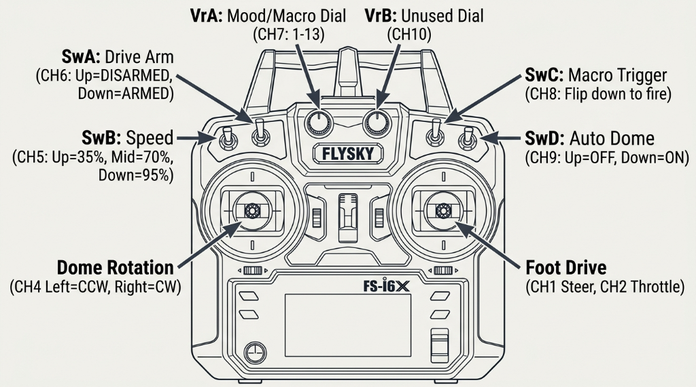

# Operating Guide

How to drive R2 and use the dome, sounds and lights. One-time setup is in [Transmitter Setup](TRANSMITTER_SETUP.md).

## Controls

| Control | What it does |
| --- | --- |
| **Right stick** | Drive. Forward/back moves, left/right turns. |
| **Left stick, left/right** | Turns the dome. Always overrides R2's own behaviour. |
| **Left stick, up/down** | Nothing |
| **SwC** (3-position) | Behaviour level. Up: Still. Middle: Aware. Down: Alive. |
| **SwB** | Flip down: play one sound from the current mood, with a matching gesture |
| **VrA** | Mood, fully anticlockwise to fully clockwise: mixed, general, chat, happy, sad, whistle |
| **VrB** | Volume. Fully anticlockwise is silent, fully clockwise is loudest. |
| **SwA, SwD** | Nothing |

## Behaviour levels (SwC)

| Level | What R2 does |
| --- | --- |
| **Still** (up) | Nothing on its own. Holos centred, no random sounds, the dome moves only with the stick. For tight spaces and people up close. |
| **Aware** (middle) | Looks around with its holos and talks. The dome stays facing front. |
| **Alive** (down) | Looks around with its dome too. The front holo glances toward something a moment before the dome turns to it. |

Losing the transmitter signal puts R2 in Still.

## Moods (VrA)

The mood sets what R2 says and how it moves.

| Mood | Character |
| --- | --- |
| General | Calm and curious. Measured looks, few sounds. |
| Chat | Sociable. Looks often end in a comment. |
| Happy | Lively. Frequent, brisk looks; holos roam widely. |
| Sad | Withdrawn. Rare, slow looks; holos low; quiet. |
| Whistle | Attentive. Looks often end with a glance back toward front. |
| Mixed | Changes to a different mood every 1–3 minutes. |

## SwB

- Flip SwB down to play one sound from the current mood, at any level. Flip it up, then down again, for another.
- In **Aware**, the front holo flicks toward front as if addressing whoever's there.
- In **Alive**, the dome adds a gesture:

| Mood | Gesture |
| --- | --- |
| General | A glance to one side and back |
| Chat | A turn partway toward front |
| Happy | A quick left-right wiggle |
| Sad | A slow half-turn away, then back |
| Whistle | Turns to face front |

## Power on

1. Transmitter **on**. Right stick centred, SwC up (Still).
2. Droid master cutoff **on**.
3. The start-up sound plays and the logics scroll their start-up text.
4. Nudge the right stick to confirm both wheels respond.
5. Set SwC to the level you want.

- The wheels stay still until the right stick has been centred after power-on.
- At power-on the dome doesn't know where it's pointing. In Alive, its first move is a slow turn until it passes the front magnets.

## Power off

1. Droid master cutoff **off**.
2. Transmitter **off**.

## Driving

- The droid drives the moment the right stick moves. There is no arming switch.
- Releasing the stick brakes the wheels.
- Driving ends any look and brings the dome back to front. R2 starts looking around again 3 seconds after you stop.
- If the transmitter switches off or goes out of range, the wheels stop and R2 goes Still.
- The master cutoff stops everything.

## Dome

- The left stick turns the dome. Speed follows how far you push. R2 waits 3 seconds after you let go before it looks around again.
- In Alive, R2 never turns more than 135° from front and comes back to front after every look.
- **The dome stops looking around and won't restart:** it failed to find the front magnets twice. Flip SwC up to Still and back down to retry. If it happens again, see [Troubleshooting](TROUBLESHOOTING.md).

## Before each session

| Check | How |
| --- | --- |
| Battery charged | Charger shows full, or the transmitter's voltage reading (optional FS-CVT01 sensor) is 13.2V or more |
| Charger unplugged | SAE lead disconnected and covered |
| Transmitter batteries | Transmitter battery indicator above half |
| Failsafe | Wheels up, drive, switch transmitter off: wheels stop |
| Clear area | No people or pets within the droid's path |

## Charging

1. Master cutoff **off**.
2. Connect the charger's SAE lead. Charger in **LiFePO4** mode.
3. Unplug the charger before switching the droid on.

Never charge below 0°C.
