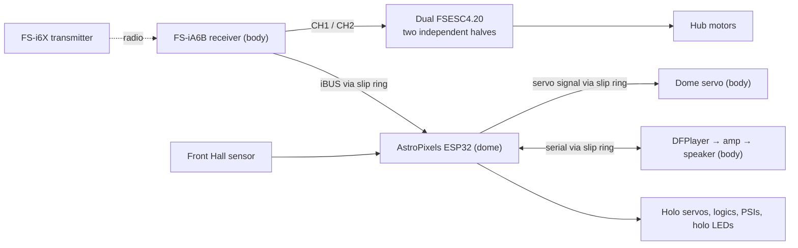

# Home Depot R2-D2 Conversion: Simplified Droid

An in-progress build that turns the 2024 Home Depot R2-D2 animatronic into a remote-controlled droid with AstroPixels lights, sound, a turning dome and powered feet.

The design keeps the number of boards and links to a minimum:

- **Feet:** driven straight from the FlySky receiver into the VESC motor controllers. No board in between.
- **Dome, sound, holos and lights:** one AstroPixels ESP32 running stock AstroPixelsPlus plus one small add-on. It reads the receiver's iBUS line to turn the dome, pick mood sounds and set the volume.
- **Failures stay separate:** if the dome board fails, the droid still drives.

## Features

| Feature | How |
| --- | --- |
| Driving | Right stick. Transmitter Elevon mix → each VESC half's receiver input. |
| Dome | Left stick, plus optional random moves that always return to front (front Hall sensor) |
| Mood sounds | VrA dial picks the mood; SwB plays one; random chatter follows the mood |
| Volume | VrB dial |
| Random holo movement | On with SwC; off with SwC up |
| Lights | Stock AstroPixels effects |

## Guides

| Guide | Contents |
| --- | --- |
| [Controller Guide](CONTROLLER_GUIDE.md) | What each stick, switch and dial does; transmitter setup; failsafe; power-on checklist |
| [Drive Setup](DRIVE_SETUP.md) | Proving the VESC receiver input, the second-half solder mod, VESC Tool settings, safety tests |
| [Signal Wiring](WIRING.md) | Receiver, VESC leads, slip ring, dome level shifter, Hall sensor, PCA9685, DFPlayer |
| [Power Harness](POWER_HARNESS_GUIDE.md) | Battery, fuses, 5V supplies, wire gauges, audio path, charging |
| [Dome Firmware](AstroPixelsPlus/HDR2D2.md) | Build and flash, SD card layout, serial log, adjusting behaviour |
| [Bill of Materials](Master_R2D2_BOM.xls) | Parts list (Excel-compatible), with unused parts marked |

## Bring-up order

Each step works on its own before the next is added.

1. **Power:** continuity checks, bucks, fuses ([Power Harness](POWER_HARNESS_GUIDE.md) §6).
2. **Drive:** prove each VESC half reads the receiver, configure VESC Tool, Elevon mix, failsafe, wheels-up safety tests ([Drive Setup](DRIVE_SETUP.md)).
3. **Dome lights:** flash the dome firmware and check lights and holo servos on the bench ([Dome Firmware](AstroPixelsPlus/HDR2D2.md)).
4. **Sound:** SD card, DFPlayer wiring through the slip ring, volume dial.
5. **Dome:** iBUS and dome servo through the slip ring, CH4 subtrim, front Hall sensor, random dome.

## Repository contents

* [`AstroPixelsPlus/`](AstroPixelsPlus/): dome firmware. Stock AstroPixelsPlus plus `R2Logic.h` / `R2Remote.h`.
* [`tests/`](tests/): PC tests for the dome firmware's logic (`python3 -m unittest discover tests`).
* [`docs/astropixels/`](docs/astropixels/): AstroPixels reference documentation.
* Mechanical:
  * [`index.html`](index.html), `app.js` and `styles.css`: foot-drive clearance visualizer.
  * [`Razor_Hub_Motor_Slotted_Mount.stl`](Razor_Hub_Motor_Slotted_Mount.stl) and [`generate_slotted_mount_stl.py`](generate_slotted_mount_stl.py): printable motor mount and its generator.
  * [`mechanical/tekno-pop-motor-mounts-wip/`](mechanical/tekno-pop-motor-mounts-wip/): work-in-progress hub motor mounts. Check fit before final assembly.

The earlier Teensy-based design (body controller, body/dome link and commissioning pages) is kept in the history of the `mmcgeary-r2-build-plan-review` branch.

## Build safety

1. **Inspect wiring unpowered.** Check crimps, gauges and terminals for shorts before connecting power.
2. **Keep the 5V rails separate.** Body and dome each have their own 5V buck; never join their outputs. Grounds are common.
3. **Flash the ESP32 out of its board.** Refit it only with all power off.
4. **Wheels in the air** for all drive setup and failsafe tests.
5. **Failsafe first.** Set the receiver failsafe and test transmitter-off and a pulled receiver lead before any floor driving.
6. **Master cutoff within reach.** Keep the 25A main fuse within 150mm of the battery.

## Credits

* **[AstroPixels Plus](https://github.com/reeltwo/AstroPixelsPlus)** by the ReelTwo team is the dome firmware's base (LGPL-2.1).
* **[AstroPixels](https://github.com/dpoulson/Astropixels)** by David Poulson: display boards and original firmware. [Documentation](https://r2djp.gitbook.io/astropixels).
* **[ReelTwo](https://reeltwo.github.io/Reeltwo/html/index.html)**: the robotics, lighting and animation framework.
* **[The Real Home Depot R2D2 Mods Group](https://www.facebook.com/groups/969844001468804)**: 3D-printable parts and conversion ideas.

This is an independent hobbyist build, not affiliated with or endorsed by Home Depot, Lucasfilm or Disney.
