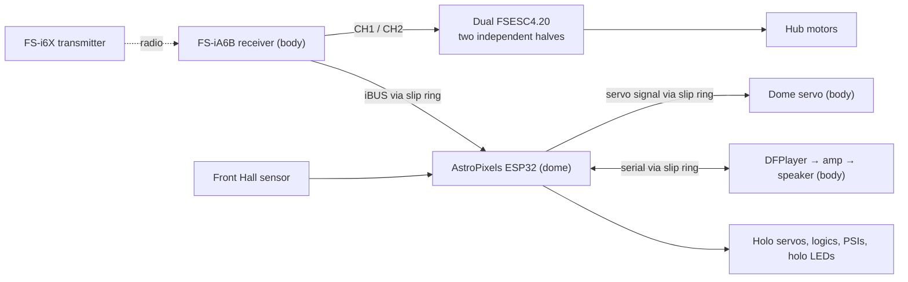

# Home Depot R2-D2 Conversion: Simplified Droid

This build turns the 2024 Home Depot R2-D2 animatronic into a remote-controlled droid with AstroPixels lights, sound, a turning dome and powered feet.

## Two versions

This repository holds two designs:

| Branch | Design |
| --- | --- |
| `simplified-droid` (this one) | Receiver drives the feet directly; one dome board runs everything else |
| `mmcgeary-r2-build-plan-review` | Teensy body controller, body/dome link protocol and web commissioning |

## How it works

- **Feet:** the FlySky receiver drives the two VESC motor controllers directly. No board sits in between.
- **Everything else:** the dome's AstroPixels ESP32 runs stock AstroPixelsPlus plus one small add-on. It reads the receiver's iBUS line and runs the dome rotation, mood sounds, volume and holo servos.
- **Independence:** a fault in the dome electronics never affects driving.

## Features

| Feature | Control |
| --- | --- |
| Drive | Right stick |
| Dome rotation | Left stick |
| Random dome moves that return to front | SwA |
| Play a mood sound | SwB |
| Mood: mixed, general, chat, happy, sad, whistle | VrA |
| Volume | VrB |
| Random chatter and holo movement | SwC |
| Lights | Always on, stock AstroPixels patterns |

## Documents

### Build

| Document | Contents |
| --- | --- |
| [Bring-Up Checklist](BRING_UP.md) | First assembly, stage by stage, with checkboxes |
| [Power](POWER.md) | Battery, fuses, 5V supplies, wire sizes, audio power, charging |
| [Wiring](WIRING.md) | Every signal connection: receiver, VESC leads, slip ring, level shifter, sensor, PCA9685, DFPlayer |
| [Bill of Materials](Master_R2D2_BOM.xls) | Parts list; unused parts marked |

### Setup

| Document | Contents |
| --- | --- |
| [Transmitter Setup](TRANSMITTER_SETUP.md) | Model, binding, channels, output mode, Elevon mix, subtrim, failsafe |
| [Drive Setup](DRIVE_SETUP.md) | VESC receiver inputs, the half-B solder modification, VESC Tool settings, safety tests |
| [Dome Setup](DOME_SETUP.md) | Flashing, lights, holo servos, radio link, Hall sensor, dome servo, random dome |
| [Sound Setup](SOUND_SETUP.md) | SD card layout and numbering, wiring, tests |

### Use

| Document | Contents |
| --- | --- |
| [Operating Guide](OPERATING_GUIDE.md) | Controls, power on/off, driving, dome, sounds, pre-session checks, charging |
| [Troubleshooting](TROUBLESHOOTING.md) | Symptoms and fixes |

### Firmware

| Document | Contents |
| --- | --- |
| [Dome Firmware](AstroPixelsPlus/HDR2D2.md) | Changes from stock, build, SD numbering, serial log, tuning, tests |

## Repository contents

| Path | Contents |
| --- | --- |
| [`AstroPixelsPlus/`](AstroPixelsPlus/) | Dome firmware: stock AstroPixelsPlus plus `R2Logic.h` and `R2Remote.h` |
| [`tests/`](tests/) | PC tests for the firmware logic: `python3 -m unittest discover tests` |
| [`docs/astropixels/`](docs/astropixels/) | AstroPixels reference documentation |
| [`docs/images/`](docs/images/) | Transmitter layout image |
| [`index.html`](index.html), `app.js`, `styles.css` | Foot-drive clearance visualizer |
| [`Razor_Hub_Motor_Slotted_Mount.stl`](Razor_Hub_Motor_Slotted_Mount.stl), [`generate_slotted_mount_stl.py`](generate_slotted_mount_stl.py) | Printable hub motor mount and its generator |
| [`mechanical/tekno-pop-motor-mounts-wip/`](mechanical/tekno-pop-motor-mounts-wip/) | Work-in-progress motor mounts. Check fit before final assembly. |

## Safety rules

1. Inspect all wiring with power off before the first power-up.
2. The body and dome 5V supplies never connect. Grounds are common.
3. Flash the ESP32 with the module out of the AstroPixels board. Refit it with power off.
4. The wheels stay off the ground for all drive setup and failsafe tests.
5. The receiver failsafe is set and tested before any floor driving.
6. The master cutoff is always within reach while the droid is on.

## Credits

* [AstroPixels Plus](https://github.com/reeltwo/AstroPixelsPlus) by the ReelTwo team: the dome firmware's base (LGPL-2.1)
* [AstroPixels](https://github.com/dpoulson/Astropixels) by David Poulson: display boards and original firmware ([documentation](https://r2djp.gitbook.io/astropixels))
* [ReelTwo](https://reeltwo.github.io/Reeltwo/html/index.html): robotics, lighting and animation framework
* [The Real Home Depot R2D2 Mods Group](https://www.facebook.com/groups/969844001468804): printable parts and conversion ideas

This is an independent hobbyist build, not affiliated with or endorsed by Home Depot, Lucasfilm or Disney.
