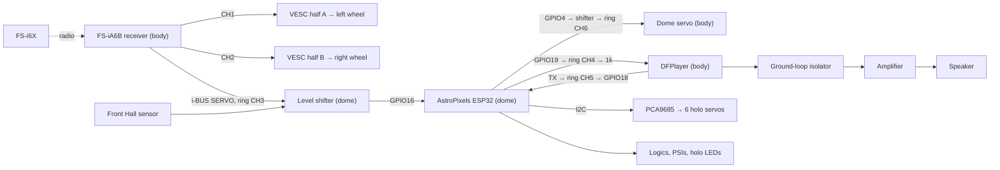

# Wiring

This guide covers every signal connection. Power, fuses and wire sizes are in [Power](POWER.md).

## Overview

There are three signal paths:

1. **Drive:** receiver CH1 and CH2 → the two VESC receiver leads.
2. **Control:** receiver iBUS → slip ring → dome ESP32. The ESP32 runs the dome servo, sounds and holo servos from it.
3. **Sound:** ESP32 ↔ slip ring ↔ DFPlayer in the body.

Every signal shares the common ground through slip ring CH2.

## 1. Body

### Receiver (FS-iA6B)

| Receiver port | Connects to | Wires |
| --- | --- | --- |
| Any + / − pins | B-LOGIC fused 5V, body ground | Power |
| CH1 | VESC half A receiver lead | Signal, ground |
| CH2 | VESC half B receiver lead | Signal, ground |
| i-BUS **SERVO** | Slip ring CH3 | Signal |
| SENS | FS-CVT01 voltage sensor (optional) | Sensor's own lead |
| CH3–CH6 | — | Unused |

The receiver's output mode is **PWM** with serial **i-BUS** ([Transmitter Setup](TRANSMITTER_SETUP.md) §4).

### VESC receiver leads

| Lead | Source | Receiver port |
| --- | --- | --- |
| Half A | Factory-soldered lead | CH1 |
| Half B | Lead soldered to the second half's pads ([Drive Setup](DRIVE_SETUP.md) §2) | CH2 |

- Remove the 5V (red) pin from both leads and insulate it. The receiver is powered from B-LOGIC.
- CH1 always goes to half A (left wheel) and CH2 to half B (right wheel). Wheel direction is set in VESC Tool, never by swapping leads.

### DFPlayer

| DFPlayer pin | Connects to |
| --- | --- |
| VCC | B-LOGIC fused 5V |
| GND | Body ground |
| RX | 1k resistor → slip ring CH4 |
| TX | Slip ring CH5 |
| DAC_L, GND | Ground-loop isolator → amplifier line input ([Power](POWER.md) §8) |
| SPK1, SPK2, BUSY | — |

Mount the 1k resistor at the DFPlayer end of the RX wire.

### Dome servo

| Servo wire | Connects to |
| --- | --- |
| + | B-SERVO fused 5V |
| − | Body ground |
| Signal | Slip ring CH6 |

## 2. Slip ring

| Contact | Body end | Dome end | Signal |
| --- | --- | --- | --- |
| CH1 | F4 7.5A fused 12V | Dome buck IN+ | Power |
| CH2 | Body ground bus | Dome ground | Ground |
| CH3 | Receiver i-BUS SERVO | Shifter HV1 | iBUS, 115200 baud, 5V |
| CH4 | 1k → DFPlayer RX | ESP32 GPIO19 (AUX5) | Sound commands, 9600 baud, 3.3V |
| CH5 | DFPlayer TX | ESP32 GPIO18 (AUX4) | DFPlayer replies, 9600 baud, 3.3V |
| CH6 | Dome servo signal | Shifter HV2 | Servo pulses, 50Hz, 5V |

Identify contacts by continuity, not colour.

## 3. Dome

### Level shifter

One Lonely Binary 4-channel board. Its "A" pins are the low-voltage side, its "B" pins the high-voltage side.

| Pin | Connects to |
| --- | --- |
| HV | D-LOGIC fused 5V |
| LV | ESP32 3.3V |
| GND | Dome ground |
| HV1 / B1 | Slip ring CH3 (iBUS in) |
| LV1 / A1 | ESP32 **GPIO16** |
| LV2 / A2 | ESP32 **GPIO4** (AUX2, dome servo out) |
| HV2 / B2 | Slip ring CH6 |
| HV3 / B3 | Front Hall sensor signal |
| LV3 / A3 | ESP32 **GPIO5** (AUX3) |
| Channel 4 | — |

ESP32 pins take 3.3V only. Every 5V signal reaches the ESP32 through this board.

### Front Hall sensor (KY-003)

| Sensor pin | Connects to |
| --- | --- |
| + | D-LOGIC fused 5V |
| − | Dome ground |
| S | Shifter HV3 |

The output goes low when the magnet is under it. The firmware reads low as "dome facing front". Mounting is in [Dome Setup](DOME_SETUP.md) §5.

### PCA9685 and holo servos

| PCA9685 pin | Connects to |
| --- | --- |
| SDA | ESP32 GPIO21 |
| SCL | ESP32 GPIO22 |
| VCC | ESP32 3.3V |
| GND | Dome ground |
| V+ terminal | D-SERVO fused 5V ([Power](POWER.md) §4) |

Leave the address jumpers open (address 0x40).

| Channel | Servo |
| --- | --- |
| 0 | Front holo, horizontal |
| 1 | Front holo, vertical |
| 2 | Rear holo, horizontal |
| 3 | Rear holo, vertical |
| 4 | Top holo, horizontal |
| 5 | Top holo, vertical |

### Lights

The front and rear logics, front and rear PSIs and the three holo LED boards plug into their own AstroPixels connectors.

## ESP32 pin map

| GPIO | Board label | Use |
| --- | --- | --- |
| 16 | Serial2 RX | iBUS in |
| 4 | AUX2 | Dome servo out |
| 5 | AUX3 | Front Hall sensor in |
| 18 | AUX4 | DFPlayer TX in |
| 19 | AUX5 | DFPlayer RX out |
| 21, 22 | I2C | PCA9685 |
| 15 | Front logic | Lights |
| 33 | Rear logic | Lights |
| 32 | Front PSI | Lights |
| 23 | Rear PSI | Lights |
| 25, 26, 27 | Front, rear, top holo | Lights |

## Harness labels

Label both ends of each signal wire:

| Label | Wire |
| --- | --- |
| RX-CH1 / RX-CH2 | Receiver to VESC half A / B |
| IBUS | Receiver i-BUS to ring CH3 to shifter HV1 |
| DF-RX | ESP32 GPIO19 to ring CH4 to 1k to DFPlayer RX |
| DF-TX | DFPlayer TX to ring CH5 to ESP32 GPIO18 |
| DOME-SERVO | Shifter HV2 to ring CH6 to servo signal |
| HALL | Sensor S to shifter HV3 |
