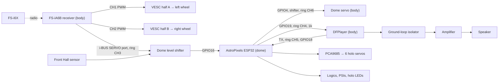

# Signal Wiring

Power, fuses and wire gauges are in the [Power Harness Guide](POWER_HARNESS_GUIDE.md). This page covers every signal connection.

There are only three signal paths:

1. **Drive:** receiver CH1/CH2 → the two VESC receiver leads. Nothing else is involved.
2. **Receiver iBUS → dome ESP32**, up the slip ring. The ESP32 runs the dome servo, sounds and holos from it.
3. **ESP32 ↔ DFPlayer**, down the slip ring, for sound.

Common ground runs everywhere through slip ring CH2. Every signal below needs it.

## 1. Body

### Receiver (FS-iA6B)

| Receiver port | Goes to | Notes |
| --- | --- | --- |
| Power (any + / − pins) | B-LOGIC fused 5V, body ground | One supply connection is enough |
| CH1 | VESC half A receiver lead | Signal + ground only |
| CH2 | VESC half B receiver lead | Signal + ground only |
| i-BUS **SERVO** | Slip ring CH3 (signal only) | 5V-level serial; shifted in the dome |
| SENS | Optional FS-CVT01 voltage sensor | Shows pack voltage on the transmitter |
| CH3–CH6 | Not used | |

Set the receiver's output mode to **PWM** with serial **i-BUS** (see the [Controller Guide](CONTROLLER_GUIDE.md)). In PPM mode, CH1 carries every channel and the VESC cannot read it.

### VESC receiver leads

- **Half A** uses the factory-soldered receiver lead.
- **Half B** uses the lead you solder to the matching pads (see [Drive Setup](DRIVE_SETUP.md)).
- **Remove the 5V (red) wire** from both leads and insulate it. The receiver is powered by the body 5V supply; the VESC's own 5V must not join it.
- Which half drives which wheel doesn't matter. Fix directions in VESC Tool.

### DFPlayer, amplifier and speaker

| DFPlayer pin | Goes to |
| --- | --- |
| VCC / GND | B-LOGIC fused 5V / body ground |
| RX | 1k resistor → slip ring CH4 |
| TX | Slip ring CH5 |
| DAC_L / GND | Ground-loop isolator → amplifier line input (see power guide §5) |
| SPK1 / SPK2, BUSY | Not used |

Put the 1k resistor in the RX line, close to the DFPlayer.

### Dome servo

| Servo wire | Goes to |
| --- | --- |
| + / − | B-SERVO fused 5V / body ground |
| Signal | Slip ring CH6 |

## 2. Slip ring

| Contact | Body end | Dome end | Signal |
| --- | --- | --- | --- |
| CH1 | F4 7.5A fused 12V | Dome buck IN+ | Power |
| CH2 | Body ground bus | Dome ground | Common ground |
| CH3 | Receiver i-BUS SERVO signal | Shifter ch1 HV | iBUS, 115200, about 5V |
| CH4 | 1k → DFPlayer RX | ESP32 GPIO19 (AUX5) | Sound commands, 9600, 3.3V |
| CH5 | DFPlayer TX | ESP32 GPIO18 (AUX4) | DFPlayer replies, 9600, 3.3V |
| CH6 | Dome servo signal | Shifter ch2 HV | Servo pulses, 50Hz, 5V |

Identify contacts by continuity, not colour. Keep the ring's signal leads away from motor phase wires.

## 3. Dome

### Level shifter (one Lonely Binary 4-channel board)

| Shifter pin | Connects to |
| --- | --- |
| HV | Dome D-LOGIC fused 5V |
| LV | ESP32 3.3V |
| GND | Dome ground |
| ch1: HV1 → LV1 | Ring CH3 (iBUS) → ESP32 **GPIO16** |
| ch2: LV2 → HV2 | ESP32 **GPIO4** (AUX2) → ring CH6 (dome servo) |
| ch3: HV3 → LV3 | Front Hall sensor output → ESP32 **GPIO5** (AUX3) |
| ch4 | Spare |

The LV side is the ESP32's own 3.3V, so nothing on the slip ring is used as a voltage reference. The ESP32's pins must never see 5V directly.

### Front Hall sensor

- Power from D-LOGIC 5V and dome ground. Signal to shifter ch3 HV.
- Mount it so the body-mounted magnet passes under it when the dome faces forward.
- Its output is low at the magnet. The firmware treats low as "front".
- Only the front sensor is used. The rear sensor isn't needed.

### PCA9685 and holo servos

- I2C: SDA GPIO21, SCL GPIO22, VCC from ESP32 3.3V, ground. Leave the board at its default address 0x40.
- V+ screw terminal: D-SERVO fused 5V and its ground return.

| PCA9685 channel | Servo |
| --- | --- |
| 0 | Front holo, horizontal |
| 1 | Front holo, vertical |
| 2 | Rear holo, horizontal |
| 3 | Rear holo, vertical |
| 4 | Top holo, horizontal |
| 5 | Top holo, vertical |

### Lights

Logics, PSIs and holo LED boards plug into the AstroPixels board's own connectors, as stock.

## ESP32 pin summary

| GPIO | AstroPixels label | Use |
| --- | --- | --- |
| 16 | Serial2 RX | Receiver iBUS in (via shifter) |
| 4 | AUX2 | Dome servo out (via shifter) |
| 5 | AUX3 | Front Hall sensor in (via shifter) |
| 18 | AUX4 | DFPlayer TX in |
| 19 | AUX5 | DFPlayer RX out |
| 21 / 22 | I2C | PCA9685 |
| 15, 33, 32, 23, 25, 26, 27 | Logic / PSI / holo | Lights, as stock |
